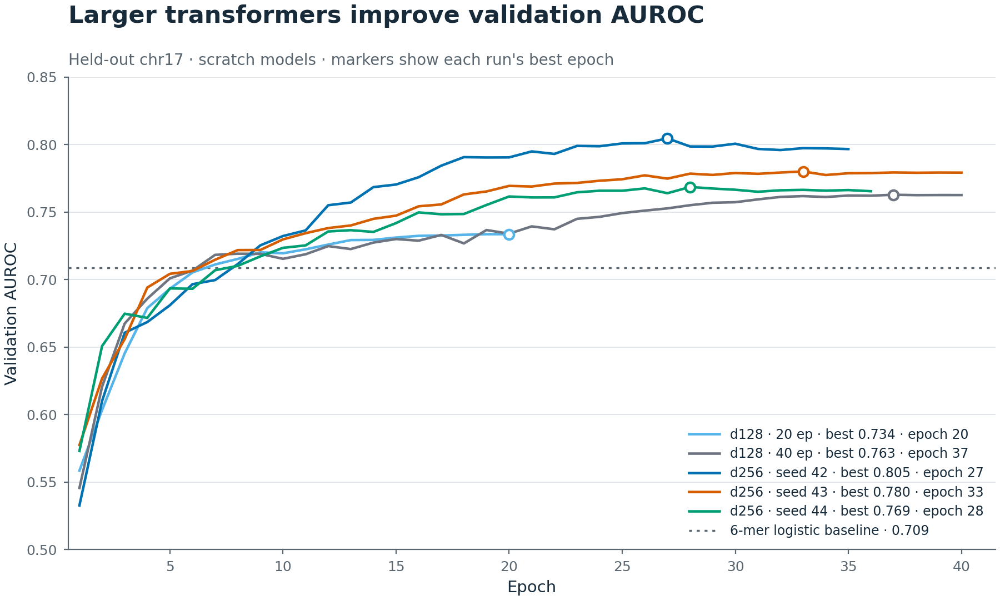
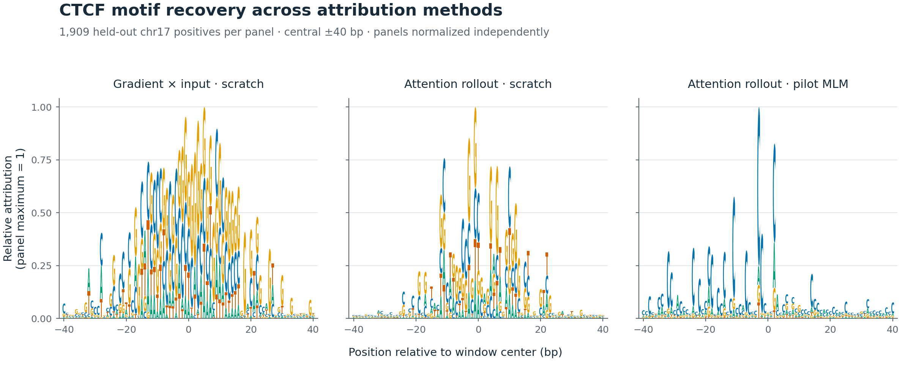
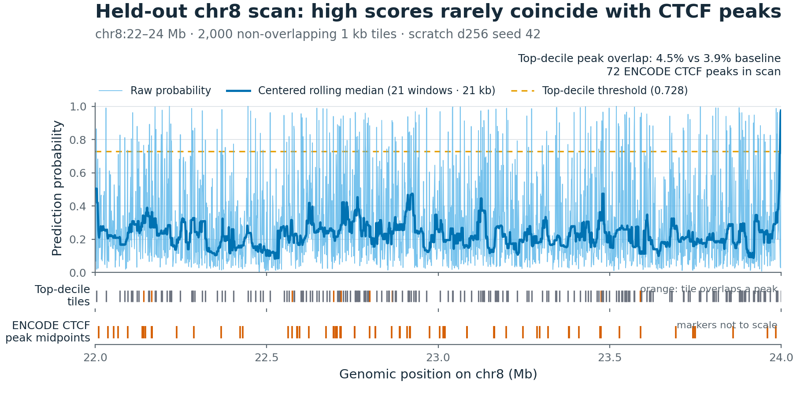

# genomic-transformer

A pilot project: predict CTCF transcription-factor binding directly from 1 kb DNA sequence, comparing a small transformer against a k-mer logistic-regression baseline — and testing whether genome-wide masked-language-model pretraining helps. Personal research project; data from ENCODE (cell line GM12878).

**Headline result:** a 2.4M-parameter transformer reaches **0.963 test AUROC** after genome-wide MLM pretraining (vs **0.798 ± 0.014** without pretraining, 3 seeds, and **0.740** for the k-mer baseline). Pretraining is the single biggest lever in this project — and the pilot-scale "pretraining doesn't help" result that preceded it is preserved below as a cautionary tale about under-trained experiments.

## Results

Validation = chr17, test = chr8 (chromosome-held-out). Metrics: AUROC / AUPRC / ACC@0.5. Full run registry (every run, config, cost): [EXPERIMENTS.md](EXPERIMENTS.md).

| Model | Params | Val AUROC | **Test AUROC** | Test AUPRC | Test ACC |
|---|---|---|---|---|---|
| k-mer logistic regression (k=6) | 2,080 feats | 0.7086 | 0.7400 | 0.7213 | 0.6744 |
| Transformer d128, 40 epochs (best of 3 arms) | 0.66 M | 0.7628 | 0.7798 | 0.7794 | 0.6945 |
| Transformer d256, scratch — **3-seed mean ± std** | 2.37 M | 0.7844 ± 0.0184 | 0.7981 ± 0.0138 | — | — |
| Transformer d256 (seed 42) | 2.37 M | 0.8045 | 0.8113 | 0.8344 | 0.7416 |
| **Transformer d256, MLM-pretrained 5 ep — full fine-tune (seed 42)** | 2.37 M | **0.9492** | **0.9633** | **0.9691** | **0.8862** |
| Transformer d256, MLM-pretrained 5 ep — frozen encoder + linear head | 2.37 M | 0.6490 | 0.6486 | 0.6297 | 0.6074 |



**Reading the pretraining rows.** Properly-scaled MLM pretraining (5 epochs × 1.5M unlabeled hg38 windows; loss 1.293 → 1.172, descending throughout) is worth **+0.165 test AUROC** over the scratch transformer. But the frozen-encoder probe shows the pretrained representation is *not* directly discriminative — with the encoder frozen, a linear head on its features only reaches 0.65. The pretraining value emerges through fine-tuning, not as off-the-shelf features. Honest caveats: the pretrained result is a single seed (a replicate is cheap future work), and the pretraining corpus spans all chromosomes, so the encoder saw held-out *sequences* as unlabeled data — standard practice in genomics pretraining, but a chromosome-held-out corpus would give a more conservative number.

## What the model learned

Gradient×input saliency and attention-rollout attribution over held-out positive windows: importance concentrates at the window center in a GC/C-rich core consistent with CTCF's known binding motif (cf. JASPAR MA0139.1). Method comparison (below): saliency is diffuse; attention rollout on the scratch model is focused; rollout on an MLM-initialized model is sharpest of all — pretraining tightens the model's internal representation even before its metric gains.



## Cross-assay transfer (JUND) — negative, and diagnosed

JUND GM12878 (7,449 ENCODE optimal-IDR peaks; identical chr17/chr8 splits): every transformer recipe and initialization tried substantially underperforms the linear baseline (scratch / MLM-init / CTCF-init; lr 3e-5–1e-3; patience disabled for 60 epochs). CTCF-init learns but overfits, while scratch and MLM-init remain near chance; a **linear k-mer model scores val 0.7952 / test 0.7967** on the same arrays. Conclusion: at 13.6k train windows a 2.4M-param transformer hits a genuine generalization gap — it memorizes or stalls at a constant-output saddle — and count-feature linear models are the stronger inductive bias at this assay size. Revisit only with a small-data recipe (k-mer-feature heads, strong regularization, far smaller models).

## Why the evaluation is trustworthy

- **Chromosome-held-out splits** baked into the dataset artifact (val = chr17, test = chr8): a random split would leak near-duplicate tiled windows into test.
- **Matched negatives**: each negative is drawn from the same chromosome × GC-bin × repeat-bin stratum as its positive (with a ring-widening relaxed-bin fallback for rare tail strata, recorded in the manifest).
- **Multi-seed** replication where it matters (scratch family; the pretrained row is single-seed and labeled as such).
- **Baseline first**: every transformer number is compared against a production-typical k-mer logistic regression, not chance.
- **Inference demo, honestly reported**: scanning raw chr8 sequence shows sharp firing at true summits but near-chance peak precision — a diagnosed out-of-distribution gap (training negatives are matched non-peak windows; the raw genome is full of hard negatives). That gap was the original motivation for pretraining.



## Quickstart

```bash
python -m venv .venv && source .venv/bin/activate
pip install -e '.[dev]'
pytest -q                     # 108 tests

# Prepare the dataset (downloads ENCODE peaks + hg38, ~1 GB; Mac ~10 min)
python -m genomic_transformer.data.prepare_ctcf --config config/data/ctcf_gm12878.yaml download
python -m genomic_transformer.data.prepare_ctcf --config config/data/ctcf_gm12878.yaml prepare

# MLM pretrain on the genome, then fine-tune (cloud config = CUDA GPU)
python -m genomic_transformer.models.pretrain \
  --fasta data/raw/ctcf_gm12878/hg38.fa \
  --config config/model/small_transformer_cloud-004_d256.yaml \
  --out-name mlm_hg38_d256_e5 --output-dir data/processed/ctcf_gm12878 \
  --windows 1500000 --epochs 5 --device cuda
python -m genomic_transformer.models.train \
  --data-config config/data/ctcf_gm12878.yaml \
  --model-config config/model/small_transformer_cloud-004_d256.yaml \
  --out-name my-run --init-from data/processed/ctcf_gm12878/mlm_hg38_d256_e5_pretrain_model.pt

# Score arbitrary sequence (BED6 output, col 5 = P(bound))
python -m genomic_transformer.models.predict --model <ckpt> --fasta hg38.fa --regions regions.bed --out scores.bed

# Extract the model's motif (saliency or attention rollout)
python -m genomic_transformer.interpret --data-config config/data/ctcf_gm12878.yaml \
  --model <ckpt> --method rollout --split validation --n-windows 2000 --out-prefix figures/ctcf
```

Cloud GPU training (Runpod): [docs/cloud-runbook.md](docs/cloud-runbook.md). A full 40-epoch fine-tune is ~$0.50 and ~30 minutes on an RTX 4090; the 5-epoch pretrain ~$1.50. Total cloud spend for every result in this README: **~$9**.

## Notes & gotchas (distilled the hard way)

- **Pilot-scale pretraining can mislead**: 1 epoch over 1.5M windows gave a nearly flat MLM loss (1.29) and "no transfer gain" (0.792 vs 0.798 scratch); 5 epochs (loss → 1.17) gave +0.165. Don't conclude from an under-trained pretrain.
- **Apple Silicon MPS**: bf16 autocast is a measured no-op on torch 2.8 (SDPA materializes fp32-sized attention matrices); memory caps and batch sizes must be tuned for fp32. CUDA has no such issue.
- **16 GB unified memory**: the MPS allocator's virtual cap (~18 GiB) exceeds physical RAM — un-capped training swap-thrashed into ~10-minute epochs.
- **Trainer hardening** (flushed logs, per-epoch JSONL, status pulse, resumable checkpoints) was written after a 7¾-hour blind run died with zero output.
- Never run full-val-set interpret jobs monolithically on the Mac — batch them or use a pod (a 15 GB-per-process memory blowup crashed the machine mid-analysis once).

## Status & future work

Done: end-to-end pipeline, leakage-controlled splits, k-mer baseline, transformer family with multi-seed scratch results, MLM pretraining at pilot and proper scale (the headline result), frozen-encoder decomposition, inference CLI with raw-genome demo, saliency + attention-rollout interpretation, a diagnosed cross-assay negative (JUND), CI on every push (108 tests).

Open (future work, not gaps): seed replicate of the pretrained result; chromosome-held-out pretraining corpus for a conservative transfer number; small-assay recipes (k-mer-feature heads / strong regularization) if JUND is revisited; richer evaluation (calibration, per-stratum breakdowns); multi-cell-line transfer.

Personal research project; not affiliated with ENCODE.

## License

MIT — see [LICENSE](LICENSE).
